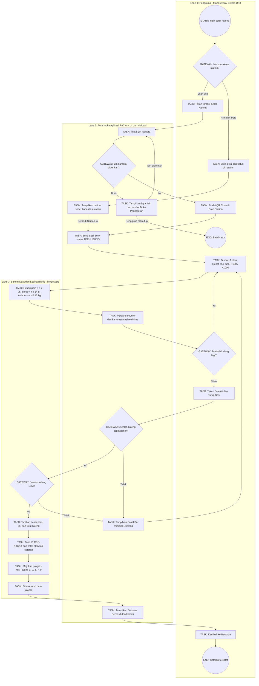
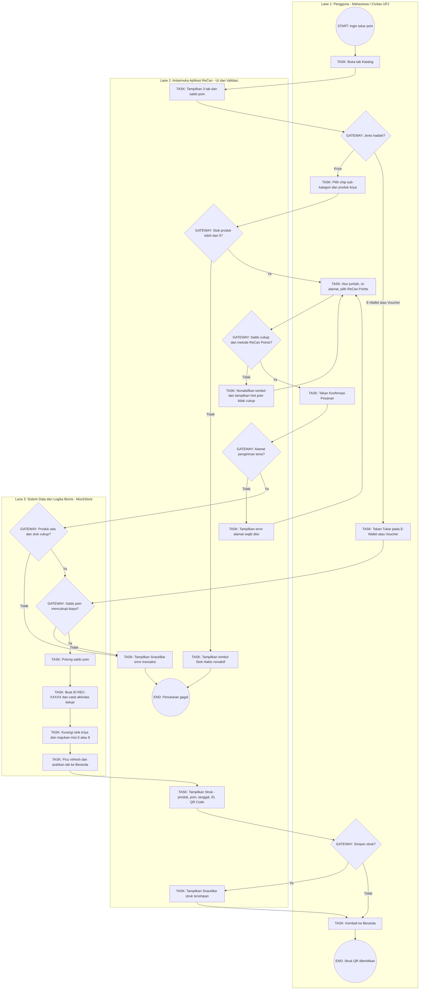
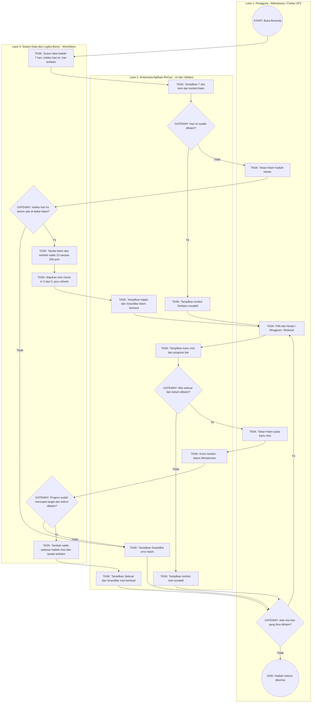
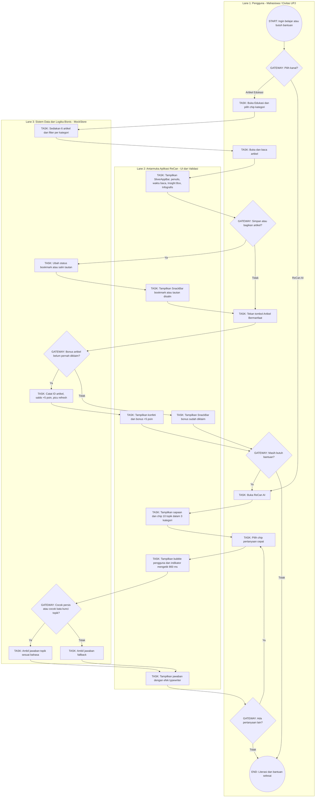

# Dokumentasi Alur Bisnis & Blueprint Swimlane — ReCan

> **Aplikasi:** ReCan — Daur Ulang Kalengmu (Flutter, mobile)
> **Konteks:** Proyek Kelompok 8, Fakultas Teknologi dan Desain, Universitas Pembangunan Jaya (UPJ)
> **Sumber kebenaran:** Kode aktual di folder `lib/` (terutama `lib/services/mock_store.dart`, `lib/models/`, `lib/services/`, `lib/pages/`, `lib/widgets/`).
> **Sifat data:** Seluruh data disimulasikan secara lokal oleh `MockStore` (state in-memory). Tidak ada server/API sungguhan; hanya token sesi dan status onboarding yang disimpan permanen via `SharedPreferences`.

---

## Daftar Isi

1. [Bagian 1 — Inventaris Fitur Lengkap](#bagian-1--inventaris-fitur-lengkap-feature-breakdown)
2. [Bagian 2 — Aturan Bisnis & Rumus Logika Sistem](#bagian-2--aturan-bisnis--rumus-logika-sistem-business-rules)
3. [Bagian 3 — User Flow End-to-End](#bagian-3--user-flow-end-to-end)
4. [Bagian 4 — Blueprint Swimlane Diagram (BPMN)](#bagian-4--blueprint-swimlane-diagram-standar-notasi-bpmn)
5. [Bagian 5 — Kode Mermaid (Siap Import ke Draw.io)](#bagian-5--kode-mermaid-diagram-siap-import-ke-drawio)
6. [Lampiran — Catatan Selisih Brief vs Implementasi](#lampiran--catatan-selisih-brief-vs-implementasi)

---

## Arsitektur Singkat (Konteks untuk Analis)

| Lapisan | Lokasi | Peran |
|---|---|---|
| Halaman (komposisi layout) | `lib/pages/` | Splash, Onboarding, Login, Home (4 tab), Scan QR, Sesi Setor, Checkout, Struk, Edukasi, Artikel, AI Chat, Profil & sub-halaman |
| Komponen UI modular | `lib/widgets/` | Kartu, tombol, carousel, grafik, bottom sheet, skeleton shimmer |
| Layanan (logika & validasi) | `lib/services/` | `AuthService`, `TransactionService`, `GamificationService`, `EducationService`, `AiChatService`, `StationService`, dll. |
| Penyimpanan state | `lib/services/mock_store.dart` | Saldo poin, misi, check-in, katalog, stok, riwayat aktivitas, bahasa |
| Model data | `lib/models/` | `DropSessionSummary`, `MemberTier`, `DailyQuest`, `EWalletOption`, `Voucher`, `CarbonImpact`, dll. |
| Sinkronisasi UI | `DataRefresh.revision` (`ValueNotifier`) | Setiap transaksi memanggil `DataRefresh.notifyChanged()` agar seluruh tab memuat ulang data |
| Navigasi antartab | `HomeNavigation.goTo(index)` | Dipakai setelah penukaran untuk kembali ke tab Beranda (index 0) |
| Bahasa global | `MockStore.isEnglish` (`ValueNotifier<bool>`) + helper `tr(id, en)` | Mengganti seluruh teks UI ID/EN secara real-time |

---

## BAGIAN 1 — INVENTARIS FITUR LENGKAP (FEATURE BREAKDOWN)

### 1.1 Alur Masuk

#### a. Splash Screen (`lib/pages/splash_page.dart`)
- **Tampilan:** Latar `AppColors.yaleBlue`, ikon daur ulang dalam kotak `pearlAqua` (96×96, radius 16), teks "ReCan" dan tagline **"Daur Ulang Kalengmu" / "Recycle Your Can"**.
- **Animasi:** Durasi 2 detik — *scale* 0.6 → 1.0 (`Curves.easeOutBack`) + *fade-in* (interval 0–70%).
- **Logika routing** (berjalan paralel dengan animasi):
  1. `AuthService.loadToken()` — membaca token `auth_token` dari `SharedPreferences`.
  2. `OnboardingService.isCompleted()` — membaca flag `onboarding_completed`.
  3. Setelah animasi selesai:
     - Onboarding belum selesai → **OnboardingPage**
     - Onboarding selesai **dan** token ada → **HomePage**
     - Onboarding selesai **dan** token tidak ada → **LoginPage**
  - Transisi: `FadePageRoute` (*pushReplacement*).

#### b. Onboarding — 3 Slide (`lib/pages/onboarding_page.dart`)
Latar gradien `butterYellow → mintMist → white`, `PageView` dengan indikator titik animasi (aktif 24px, non-aktif 8px).

| Slide | Judul (ID) | Judul (EN) | Pesan (ID) | Ilustrasi |
|---|---|---|---|---|
| 1 | Daur Ulang **Sampah** Bekasmu | Recycle Your **Waste** Material | "Setor kaleng bekasmu ke station terdekat dan ubah kebiasaan kecil menjadi kampus yang lebih bersih." | `ilustrasi_1.png` |
| 2 | **Dasbor** | Your **Dashboard** | "Pantau setoran, streak, dan dampak karbonmu dalam satu tempat." | `ilustrasi_2.png` |
| 3 | Tukarkan **Poin** | Redeem your **Points** | "Tukarkan poin yang kamu kumpulkan dengan kriya daur ulang dan hadiah e-wallet." | `ilustrasi_3.png` |

- Tombol **"Lewati / Skip"** (kanan atas) — disembunyikan di slide terakhir.
- Tombol utama **"Lanjut / Next"** → berubah menjadi **"Mulai / Get Started"** di slide 3 (animasi `AnimatedSwitcher`).
- Lewati atau Mulai → `OnboardingService.markCompleted()` → **LoginPage**.

#### c. Login (`lib/pages/login_page.dart`, `lib/services/auth_service.dart`)
- **Header:** Logo putih ReCan, judul "ReCan", tagline; latar `deepIndigo` dengan dekorasi `PillBackdrop`.
- **Sheet putih** (radius atas 32) berjudul **"Halo! / Hello!"** dengan 3 field:

| Field | Validasi (UI) | Pesan Error |
|---|---|---|
| Username | Wajib diisi (setelah trim) | "Username wajib diisi" |
| Email | Wajib diisi; harus mengandung `@` | "Email wajib diisi" / "Format email tidak valid" |
| Password | Wajib diisi; ada tombol mata (show/hide) | "Password wajib diisi" |

- Tombol **"Masuk / Login"** (`GradientPillButton`, dengan state loading).
- **Proses `AuthService.login()`:**
  - Validasi ulang email & password tidak kosong (jika gagal → `AuthException` → SnackBar).
  - `MockStore.userEmail = email`.
  - **Username dinamis:** bila username tidak kosong → `MockStore.currentUsername = username` (default `'Guest'`). Nama ini muncul di header Beranda ("Halo, {nama}"), Profil, dan Papan Peringkat.
  - Menyimpan token tiruan `'mock-session'` ke `SharedPreferences` (`auth_token`).
  - Navigasi ke **HomePage**.

### 1.2 Kerangka Utama — HomePage (`lib/pages/home_page.dart`)
- **Bottom Navigation kustom** (`CurvedNavBar`) dengan 4 tab: **Beranda**, **Katalog**, **Aktivitas**, **Profil**.
- Transisi antartab: `AnimatedSwitcher` 250 ms (fade).
- Mendengarkan `HomeNavigation.requestedTab` untuk pindah tab secara programatik.
- Logout dari tab mana pun → `AuthService.logout()` (hapus token) → **LoginPage**.

### 1.3 Beranda / Dashboard (`lib/pages/beranda_page.dart`)
Data dimuat via `AsyncView` dengan skeleton shimmer (`DashboardSkeleton`) dan *pull-to-refresh*. Seluruh isi otomatis dimuat ulang saat `DataRefresh.revision` berubah.

| # | Komponen | Detail Implementasi |
|---|---|---|
| 1 | **Header Saldo Poin** (`PointsHeader`) | Sapaan "Halo, {username}", saldo poin dengan **animated counter** (`TweenAnimationBuilder<int>` 0 → saldo, 700 ms), ekuivalen Rupiah (1 poin = Rp 1). |
| 2 | **Notifikasi** | Ikon lonceng (`CircleIconButton`) → SnackBar "Belum ada notifikasi baru". |
| 3 | **Quick Action** | **Setor Kaleng** → `ScanQrPage`; **Tukar Poin** → tab Katalog (index 1). |
| 4 | **Promo Banner Carousel** (`PromoBannerCarousel`) | 5 banner, **infinite loop** (60 halaman virtual, mulai di halaman 30, *recenter* otomatis saat ≤5 halaman dari tepi), **auto-slide tiap 4 detik**, animasi geser 600 ms, `viewportFraction 0.92`. |
| 5 | **Hadiah Harian** (`DailyCheckInSection`) | 7 slot koin (Senin–Minggu), tombol "Klaim +{n} Poin" / "Terklaim". |
| 6 | **Misi 3 Periode** (`DailyQuestSection`) | Tab pil Harian / Mingguan / Bulanan, kartu misi dengan progress bar & tombol Klaim. |
| 7 | **Dampak Bersama & Kamu** (`ImpactSection`) | Statistik komunitas statis: total 1.240,5 kg kaleng, 1.860 kg CO₂, kontribusi user 5,7 kg. |
| 8 | **Sustainability & Carbon Impact Dashboard** (`CarbonAnalyticsSection`) | 3 chip filter rentang waktu, 3 kartu metrik (Kaleng Terkumpul, Karbon kg CO₂e, % Target Kampus Hijau UPJ), grafik garis `fl_chart` (`LineChart`). |
| 9 | **Drop Station** | Daftar 3 kartu station + tombol "Lihat Semua" → **Peta Drop Station**. |
| 10 | **Preview Katalog Daur Ulang** | Daftar horizontal `ProductCard` (6 kriya) → `ProductDetailPage`; "Lihat Semua" → tab Katalog. |
| 11 | **Preview Edukasi ReCan** | 2 artikel unggulan (`EducationService.featured`) → `ArticleDetailPage`; "Lihat Semua" → `EdukasiPage`. |
| 12 | **AI Chat FAB** | Tombol mengambang kanan bawah → `AiChatPage`. |

**Isi 5 Promo Banner:**

| # | Judul (ID) | Sub-judul | Aksi Ketuk |
|---|---|---|---|
| 1 | Tukar Kaleng Jadi Miniatur F1 & Jet! | Kumpulkan poin, tukar kriya impianmu | Tab Katalog |
| 2 | Bonus Poin Akhir Pekan! | Setor kaleng sekarang dan rasakan bedanya | Scan QR |
| 3 | Kampanye SDG 11 & 12 UPJ | Kampus berkelanjutan, konsumsi bertanggung jawab | Halaman Edukasi |
| 4 | Tukar Poin Jadi Saldo E-Wallet | GoPay, OVO, dan DANA mulai Rp 20.000 | Tab Katalog |
| 5 | Tantangan Bebas Emisi | Setor tiap hari, hemat karbon, raih Eco-Hero | Tab Profil |

**Peta Drop Station** (`lib/pages/drop_station_map_page.dart`, `StationService`):
- Peta OpenStreetMap (`flutter_map`) berpusat di kampus UPJ (−6.2741, 106.7345) dengan 3 pin station.
- Ketuk pin → `StationBottomSheet`: nama, kapasitas terisi (%), bar kapasitas, peringatan **"Hampir penuh, pertimbangkan station lain."** bila kapasitas ≥ 80%, tombol **"Setor di Station Ini"** → `DropSessionPage`.

| ID | Station | Lokasi | Kapasitas | Jarak |
|---|---|---|---|---|
| 201 | Drop Station Gedung Utama UPJ | Lobi Gedung Utama | 35% | 120 m |
| 202 | Drop Station Kantin UPJ | Area Kantin Kampus | 85% (hampir penuh) | 340 m |
| 203 | Drop Station Perpustakaan UPJ | Teras Perpustakaan | 60% | 510 m |

Warna kapasitas (`CapacityStyle`): > 80% merah (`danger`), 50–80% kuning (`warning`), < 50% hijau.

### 1.4 Simulasi Setor Kaleng & Scanner

#### a. Scan QR (`lib/pages/scan_qr_page.dart`)
- Meminta izin kamera (`CameraPermissionService`: `granted` / `denied` / `permanentlyDenied`).
- Izin ditolak → layar "Izin kamera diperlukan" dengan tombol **"Izinkan Kamera"** atau **"Buka Pengaturan"** (jika ditolak permanen). Izin dicek ulang saat aplikasi kembali aktif (*resumed*).
- Izin diberikan → `MobileScanner` + overlay bingkai, instruksi "Arahkan ke QR Code di Drop Station".
- QR apa pun terbaca (rawValue tidak null) → membuka `DropSessionPage` dengan nama station tiruan **"Drop Station Kampus Utama"**.
- **Jalur alternatif pemilihan station:** dari Peta Drop Station → pin → "Setor di Station Ini" (nama station sesuai pin).

#### b. Sesi Setor (`lib/pages/drop_session_page.dart`)
- Label status **"TERHUBUNG"** dan nama station.
- Penghitung kaleng (`BounceCounter`, animasi memantul 360 ms) dan penghitung poin.
- **Tombol simulasi +1** (masukkan 1 kaleng, getaran haptic ringan).
- **Preset kolektif** (`CanPresetChips`): **+5**, **+20**, **+100**, **+1000 (Kolektif Kampus / Event)**.
- **Kartu estimasi real-time** (`DropEstimateCard`): Estimasi Poin Didapat, Estimasi Berat Kaleng (gram, otomatis berubah ke kg bila ≥ 1.000 g), Estimasi Karbon Diselamatkan (kg CO₂e).
- Tombol **"Selesai & Tutup Sesi"**:
  - Jumlah kaleng 0 → SnackBar "Masukkan minimal 1 kaleng dulu."
  - Jumlah > 0 → `TransactionService.submitDrop(cans)` → `MockStore.recordDeposit()` → **DropSuccessPage**.

#### c. Setoran Berhasil (`lib/pages/drop_success_page.dart`)
- Animasi centang + konfeti (3 detik), judul "Setoran Berhasil".
- Ringkasan: **Total Kaleng**, **Poin Didapat**, **Dampak Karbon**.
- Tombol **"Kembali ke Beranda"** (`popUntil` route pertama).

### 1.5 Katalog Penukaran Poin — 3 Tab (`lib/pages/katalog_page.dart`)

| Tab | Isi & Komponen |
|---|---|
| **Kriya ReCan** | Chip sub-kategori **Semua / Mainan / Hiasan** (`FilterChipRow`), grid `ProductCard` → `ProductDetailPage` (cover parallax, stok, deskripsi, cerita "Dari Kaleng Menjadi Karya", spesifikasi: Material 100% Aluminium Upcycle, Dimensi Presisi Skala 1:18, Kondisi Baru & Dilapisi Anti-Karat). Tombol **"Tukar Sekarang"** / "Stok Habis" (nonaktif jika stok 0) → `CheckoutPage`. |
| **E-Wallet** | Banner saldo poin; dikelompokkan per provider **GoPay, OVO, DANA**, masing-masing 3 nominal (Rp 20.000 / 50.000 / 100.000) dalam `EWalletTile`. Tombol "Tukar" berwarna aktif hanya jika saldo cukup (tetap bisa diketuk; validasi akhir di MockStore). |
| **Voucher Diskon** | `VoucherTicketCard` berbentuk **tiket bergerigi** (`_TicketClipper` — potongan setengah lingkaran radius 12 pada garis sobek + stub kanan berisi harga poin & tombol "Tukar"). |

### 1.6 Checkout & Struk Digital (E-Receipt)

#### a. Checkout Kriya (`lib/pages/checkout_page.dart`)
- **Ringkasan Pesanan:** gambar, nama, stok tersisa, `QuantityStepper` (min 1, maks = stok).
- **Detail Pengiriman:** "Alamat Pengiriman Kampus / Rumah" (**wajib**) dan "Catatan" (opsional, "Pesan untuk penjual").
- **Metode Pembayaran:** `ReCan Points`, `QRIS`, `GoPay`, `Transfer Bank`. **Hanya ReCan Points yang aktif**; metode lain berlabel "Belum tersedia". Hint saldo: "Saldo kamu: X poin" atau "Poin tidak cukup (saldo X poin)".
- **Bar Total Pembayaran** + tombol **"Konfirmasi Pesanan"** — aktif hanya jika stok > 0, tidak sedang memproses, dan metode = ReCan Points.
- **Pengecekan berlapis:** alamat kosong → error di field; stok < kuantitas → "Stok produk tidak mencukupi."; saldo < total → "Poin kamu tidak cukup."; produk tidak ada → "Produk tidak ditemukan."
- Sukses → pemotongan poin, pengurangan stok, pembuatan ID transaksi, `HomeNavigation.goTo(0)`, lalu **CheckoutSuccessPage** (menggantikan halaman checkout).

#### b. E-Wallet & Voucher
- Penukaran **langsung satu ketukan** (tanpa halaman checkout) → `TransactionService.redeemEWallet()` / `redeemVoucher()` → **CheckoutSuccessPage**.

#### c. Struk Digital (`lib/pages/checkout_success_page.dart`)
- Getaran haptic, lencana **"Berhasil"**, judul **"Penukaran Berhasil!"**, sub-judul "Simpan struk ini sebagai bukti".
- Rincian: **Produk**, **Poin Dipotong**, **Tanggal** (waktu penukaran), **ID Transaksi** (`REC-XXXXX`).
- **QR Code** (`QrImageView`) berisi string ID transaksi.
- Tombol **"Simpan Struk"** → haptic + SnackBar "Struk berhasil disimpan ke perangkat" (simulasi; tidak menulis file).
- Tombol **"Kembali ke Beranda"**.

### 1.7 Riwayat Aktivitas (`lib/pages/aktivitas_page.dart`)
- Daftar mutasi (`ActivityHistoryList`) dikelompokkan per tanggal dengan label relatif **"Hari ini"**, **"Kemarin"**, atau tanggal lengkap (`IndonesianDate`).
- **Poin masuk (+)** — setoran — berwarna **hijau** (`AppColors.success`); **poin keluar (−)** — penukaran — berwarna **merah** (`AppColors.danger`).
- Ketuk item → **Bottom Sheet detail resi** (`ActivityDetailSheet`): nominal poin, ID Transaksi, Jenis (Setoran Kaleng / Penukaran Produk), Waktu, Lokasi (Drop Station UPJ / Katalog ReCan), Status "Berhasil", Berat (khusus setoran), tombol "Tutup".
- *Empty state* "Belum ada aktivitas" dan *pull-to-refresh*.

### 1.8 Edukasi ReCan & Blog Interaktif

#### a. Daftar Artikel (`lib/pages/edukasi_page.dart`)
- Chip filter kategori: **Semua**, **Tentang ReCan**, **Pentingnya Daur Ulang**, **Dampak Lingkungan**.

| ID | Judul | Kategori | Waktu Baca |
|---|---|---|---|
| 1 | Apa Itu ReCan dan Bagaimana Cara Kerjanya | Tentang ReCan | 3 menit |
| 2 | Dari Kaleng Bekas Menjadi Kriya Bernilai | Tentang ReCan | 4 menit |
| 3 | Mengapa Aluminium Layak Didaur Ulang | Pentingnya Daur Ulang | 4 menit |
| 4 | Tips Memilah Sampah di Kos dan Kampus | Pentingnya Daur Ulang | 3 menit |
| 5 | Jejak Karbon yang Kamu Hemat Setiap Hari | Dampak Lingkungan | 4 menit |
| 6 | Kampus Bersih, Bumi Lestari | Dampak Lingkungan | 5 menit |

#### b. Halaman Baca Artikel (`lib/pages/article_detail_page.dart`)
- **SliverAppBar** dengan cover parallax (`ParallaxCoverAppBar`), tombol **Bookmark** (toggle, SnackBar "Artikel disimpan ke bookmark"/"dihapus dari bookmark") dan **Share** (SnackBar "Tautan artikel disalin").
- **Metadata:** penulis "Tim Riset ReCan UPJ" + "{n} menit baca".
- Isi paragraf, **Insight Box** (kotak sorotan), **Infografis 3 angka** (`ArticleInfographic`, mis. artikel 1: 25 Poin per kaleng · 3 Drop Station · 3 Tier member).
- **Kartu "Apakah artikel ini bermanfaat?"** (`HelpfulBonusCard`) → klaim **+5 poin literasi** sekali per artikel, disertai animasi konfeti.
- **"Artikel Terkait Lainnya"** — 3 artikel, kategori sama diprioritaskan.

### 1.9 ReCan AI Assistant / Chatbot (`lib/pages/ai_chat_page.dart`, `lib/services/ai_chat_service.dart`)
- Dibuka dari FAB Beranda atau "Tanya ReCan AI" di Pusat Bantuan.
- Sapaan pembuka: "Halo! Aku ReCan AI, asisten lingkungan kamu. Pilih salah satu pertanyaan di bawah ya. ♻️"
- Interaksi **berbasis chip pertanyaan cepat** (`ChatSuggestionChips`) dengan filter kategori "Semua" + 3 kategori. Jeda "berpikir" 900 ms dengan `TypingIndicator`, lalu jawaban dengan efek *typewriter*.
- **10 topik dalam 3 kategori** (seluruh pertanyaan & jawaban bilingual ID/EN):

| Kategori | # | Pertanyaan Cepat | Inti Jawaban |
|---|---|---|---|
| **Umum** | 1 | Apa itu ReCan? | Aplikasi daur ulang kaleng civitas kampus; setor → poin → tukar kriya/e-wallet |
| Umum | 2 | Dampak limbah kaleng bagi lingkungan | Terurai 50–200 tahun; daur ulang hemat 95% energi; 1 kaleng ≈ 0,13 kg karbon |
| Umum | 3 | Bantuan akun bermasalah | Keluar–masuk ulang, Edit Profil, atau Pusat Bantuan |
| **Setor Kaleng** | 4 | Berapa poin per kaleng? | 25 poin/kaleng; 20 kaleng = 500 poin; 1000 kaleng = 25.000 poin |
| Setor Kaleng | 5 | Lokasi Drop Station UPJ | Gedung Utama, Kantin, Perpustakaan; lihat peta |
| Setor Kaleng | 6 | Syarat kaleng yang diterima | Hanya kaleng minuman aluminium, kosong, dibilas, dipipihkan |
| **Poin & Hadiah** | 7 | Cara tukar poin & E-Wallet | Tab Katalog; e-wallet mulai Rp 20.000 |
| Poin & Hadiah | 8 | Apa itu produk Kriya Upcycling? | Miniatur F1, jet, mobil klasik, pinisi, vas, lampu meja |
| Poin & Hadiah | 9 | Bagaimana sistem Tier Member? | Bronze < 1.000, Silver 1.000–5.000, Gold > 5.000 |
| Poin & Hadiah | 10 | Cara kerja Misi Harian/Bulanan | Misi harian/mingguan/bulanan, klaim di Beranda |

- **Algoritma pencocokan** (`AiChatService.send`): normalisasi teks (huruf kecil, buang simbol) → (1) cocok persis dengan pertanyaan → (2) cocok kata kunci → (3) jawaban *fallback* "Tanyakan seputar poin, setor kaleng, katalog, tier, atau misi harian ya!".

### 1.10 Profil & Pengaturan (`lib/pages/profil_page.dart`)

| Komponen | Detail |
|---|---|
| **Kartu Profil** (`AccountHeader`) | Avatar, nama (username), email, **badge Tier** (Bronze/Silver/Gold + emoji). |
| **Kartu Tier Status + Progress Bar** (`ProfileSummaryCards`) | Tier saat ini, progres menuju tier berikutnya; ketuk → `TierInfoPage` (keuntungan tiap tier). |
| **My Voucher / Voucher Saya** | Kartu ringkas "0 Aktif" (statis). |
| **Metode Pembayaran** (`PaymentMethodSection`) | Saldo (poin × Rp 1) dan **GoPay** dengan tombol **"Hubungkan"** → SnackBar "GoPay berhasil terhubung", status "Terhubung". |
| **Papan Peringkat Kampus** | "Top Pahlawan Lingkungan" — user + 4 pesaing tiruan diurutkan berdasarkan kg. |
| **Pengaturan** | Edit Profil (nama & email, tervalidasi), **Language \| Bahasa** (bottom sheet Indonesia/English — mengganti bahasa global seketika), Pusat Bantuan (FAQ + tombol Tanya ReCan AI), Tentang, Legal & Kebijakan, **Keluar** (dialog konfirmasi). |

**Halaman About ReCan** (`about_recan_page.dart`):
- *Masalah Limbah Kaleng* — kaleng terurai **50–200 tahun**, daur ulang hemat energi hingga 95%.
- *Visi Ekonomi Sirkular* — chip **SDG 11 · Kota & Komunitas Berkelanjutan** dan **SDG 12 · Konsumsi & Produksi Bertanggung Jawab**.
- *3 Pilar Kolaborasi* (lintas disiplin UPJ): **Sistem Informasi** (aplikasi & gamifikasi), **Arsitektur** (desain modular Drop Station), **DKV** (identitas visual & kriya upcycling).
- *Tim Pengembang Proyek — Kelompok 8 FTD UPJ*: Rayhan Christian Wewengkang (Ketua), Fizar Erlansyah, Darrel Musyaffa Reyhan, Nailah Tsabita Alhadi, Shaina Zafira (Anggota); Dosen Pengampu: Ibu Safitri Jaya, S.Kom., M.T.I.

**Halaman Legal & Policies** (`legal_policies_page.dart`) — 2 Tab:
- **Syarat & Ketentuan:** Aturan Pemilahan Kaleng, Validitas Poin, Tier Misi & Hadiah, Ketentuan Umum.
- **Kebijakan Privasi:** Data yang Kami Kumpulkan, Penggunaan Data, Keamanan Data, Hak Pengguna.

---

## BAGIAN 2 — ATURAN BISNIS & RUMUS LOGIKA SISTEM (BUSINESS RULES)

### 2.1 Rumus Konversi Kaleng (`lib/models/drop_session_summary.dart`)

| Konstanta | Nilai |
|---|---|
| `pointsPerCan` | **25 poin** per kaleng |
| `gramsPerCan` | **14 gram** per kaleng |
| `carbonKgPerCan` | **0,13 kg CO₂e** per kaleng |

```
Poin            = jumlah_kaleng × 25
Berat (gram)    = jumlah_kaleng × 14
Berat (kg)      = Berat (gram) ÷ 1000          (tampilan otomatis "kg" bila ≥ 1.000 g)
Karbon (kgCO2e) = jumlah_kaleng × 0,13
Ekuivalen Rupiah saldo = poin × 1               (PointsHeader.rupiahPerPoint = 1)
```

**Contoh perhitungan preset:**

| Kaleng | Poin | Berat | Karbon Diselamatkan |
|---|---|---|---|
| 1 | 25 | 14 g | 0,13 kg CO₂e |
| 5 | 125 | 70 g | 0,65 kg CO₂e |
| 20 | 500 | 280 g | 2,60 kg CO₂e |
| 100 | 2.500 | 1,4 kg | 13,00 kg CO₂e |
| 1.000 | 25.000 | 14 kg | 130,00 kg CO₂e |

**Efek `MockStore.recordDeposit(cans)`:**
1. `points += cans × 25`
2. `depositedKg += (cans × 14) / 1000` (dipakai Papan Peringkat)
3. `userTotalCans += cans`, `userTodayCans += cans` (dipakai grafik karbon)
4. Menyisipkan aktivitas `ActivityType.deposit` di urutan teratas dengan ID `REC-XXXXX`, judul "Setor {n} Kaleng", poin (+), berat kg.
5. `_advanceQuests(QuestMetric.cans, cans)` — menambah progres semua misi bertipe kaleng yang belum diklaim.

### 2.2 Rumus Dashboard Karbon Kampus (`MockStore.carbonImpact`)

```
indeks_bulan(m)        = (tahun − 2025) × 12 + (bulan − 1)
kaleng_kampus_bulan(m) = 900 + 60·m + (m mod 3)·70
```

| Filter | Titik Data | Rumus per Titik | Target Kampus (`goalCans`) |
|---|---|---|---|
| **7 Hari** | 7 hari terakhir (Sen–Min) | `round(kaleng_kampus_bulan_ini ÷ 30 × faktor_hari)` + `userTodayCans` (hanya hari ini). Faktor hari Sen–Min: 0.9, 1.1, 0.8, 1.2, 1.0, 0.7, 1.3 | 700 kaleng |
| **Bulanan** | 4 minggu (Mg 1–4) | `round(kaleng_kampus_bulan_ini × porsi_minggu)` + `userTotalCans` (hanya Mg 4). Porsi: 0.22, 0.26, 0.24, 0.28 | 3.000 kaleng |
| **Sejak 1 Jan 2025** | Tiap bulan sejak Jan 2025 | `kaleng_kampus_bulan(i)` + `userTotalCans` (hanya bulan berjalan) | 45.000 kaleng |

```
Total Karbon (kg CO2e) = total_kaleng × 0,13
% Target               = clamp(total_kaleng ÷ goalCans × 100, 0, 100)
```

### 2.3 Katalog Penukaran

#### a. Kriya ReCan (`MockStore.products`)

| ID | Produk | Sub-kategori | Harga Poin | Harga Rupiah | Stok Awal |
|---|---|---|---|---|---|
| 1 | Miniatur F1 | Mainan | 15.000 | Rp 150.000 | 8 |
| 2 | Miniatur Jet Tempur | Mainan | 20.000 | Rp 200.000 | 5 |
| 3 | Miniatur Mobil Klasik | Mainan | 12.000 | Rp 120.000 | 10 |
| 4 | Miniatur Kapal Pinisi | Hiasan | 18.000 | Rp 180.000 | 4 |
| 5 | Vas Bunga Kaleng | Hiasan | 9.000 | Rp 90.000 | 12 |
| 6 | Lampu Meja Kaleng | Hiasan | 14.000 | Rp 140.000 | 6 |

Total biaya = `pricePoints × kuantitas`. Stok berkurang sebanyak kuantitas setelah transaksi sukses.

#### b. E-Wallet (`EWalletOption`) — `pointsCost = nominal × 1`, stok tidak terbatas

| Provider | Rp 20.000 | Rp 50.000 | Rp 100.000 |
|---|---|---|---|
| GoPay | 20.000 poin | 50.000 poin | 100.000 poin |
| OVO | 20.000 poin | 50.000 poin | 100.000 poin |
| DANA | 20.000 poin | 50.000 poin | 100.000 poin |

#### c. Voucher Diskon Kampus (`MockStore.vouchers`) — stok tidak terbatas

| ID | Voucher | Deskripsi | Harga Poin |
|---|---|---|---|
| 1 | Diskon Kantin 20% | Berlaku untuk semua menu di Kantin UPJ | 500 |
| 2 | Gratis Parkir UPJ | Gratis parkir motor satu hari di area kampus | 800 |
| 3 | Diskon Fotokopi 30% | Potongan fotokopi & cetak di koperasi kampus | 300 |

#### d. Aturan Transaksi Penukaran (`MockStore._spend`)
1. Jika `saldo < biaya` → gagal: **"Poin kamu tidak cukup."**
2. `saldo −= biaya`.
3. ID transaksi = `"REC-"` + 5 karakter acak dari alfabet `0123456789ABCDEFGHJKLMNPQRSTUVWXYZ` (tanpa huruf **I** dan **O** agar tidak tertukar dengan 1 dan 0).
4. Aktivitas `ActivityType.redeem` disisipkan di urutan teratas dengan poin negatif.
5. Efek misi: Kriya → `QuestMetric.product +1` (per transaksi, bukan per kuantitas); Voucher → `QuestMetric.voucher +1`; E-Wallet → tidak memajukan misi.

### 2.4 Tier Member (`lib/models/member_tier.dart`)

| Tier | Emoji | Syarat Saldo Poin (logika kode) | Label UI | Target Berikutnya | Keuntungan |
|---|---|---|---|---|---|
| **Bronze** | 🥉 | `poin < 1.000` | Kurang dari 1.000 Poin | Silver @ 1.000 | Akses Drop Station dasar; kumpulkan poin dari setiap setoran |
| **Silver** | 🥈 | `1.000 ≤ poin < 5.000` | 1.000 – 5.000 Poin | Gold @ 5.000 | Diskon redeem 5%; Misi Harian ekstra |
| **Gold** | 🥇 | `poin ≥ 5.000` | Lebih dari 5.000 Poin | — (maks) | Prioritas redeem produk premium (Jet/F1); merchandise eksklusif |

```
Progress bar tier = clamp(poin ÷ target_tier_berikutnya, 0, 1)   (Gold = 1,0)
```
> Tier dihitung dari **saldo poin saat ini** (bukan akumulasi seumur hidup), sehingga tier dapat turun setelah penukaran. Keuntungan tier bersifat informatif (belum diterapkan pada perhitungan harga).

### 2.5 Daftar 9 Misi (`MockStore.quests`)

| ID | Periode | Misi | Pemicu (`QuestMetric`) | Progres Awal | Target | Hadiah |
|---|---|---|---|---|---|---|
| 1 | Harian | Setor 5 Kaleng Hari Ini | `cans` — setoran kaleng | 2 | 5 kaleng | **50** poin |
| 2 | Harian | Setor 10 Kaleng Hari Ini | `cans` — setoran kaleng | 2 | 10 kaleng | **150** poin |
| 3 | Harian | Klaim Hadiah Harian | `checkIn` — klaim check-in | 0 | 1 klaim | **20** poin |
| 4 | Mingguan | Setor 15 Kaleng Minggu Ini | `cans` — setoran kaleng | 5 | 15 kaleng | **200** poin |
| 5 | Mingguan | Klaim 3 Hadiah Harian | `checkIn` — klaim check-in | = jumlah hari sebelum hari ini dalam minggu berjalan | 3 klaim | **120** poin |
| 6 | Mingguan | Tukar 1 Voucher Minggu Ini | `voucher` — redeem voucher | 0 | 1 voucher | **100** poin |
| 7 | Bulanan | Kontributor Eco-Hero 50 Kaleng | `cans` — setoran kaleng | 12 | 50 kaleng | **600** poin |
| 8 | Bulanan | Tukar 1 Produk Kriya | `product` — redeem kriya | 0 | 1 produk | **300** poin |
| 9 | Bulanan | Setor 100 Kaleng Bulan Ini | `cans` — setoran kaleng | 12 | 100 kaleng | **1.500** poin |

**Total potensi hadiah misi:** 3.040 poin.

**Aturan klaim misi (`MockStore.claimQuest`):**
```
isCompleted = progress ≥ target
canClaim    = isCompleted AND NOT isClaimed
Jika canClaim → saldo += rewardPoints; isClaimed = true
Jika tidak    → error "Misi belum bisa diklaim."
```
- Progres yang ditampilkan dibatasi maksimal = target (`displayProgress`), rasio progres di-*clamp* 0–1.
- Misi yang sudah diklaim tidak lagi menerima progres.
- UI mencegah klik ganda (`_claimingIds`) dan menampilkan "Memproses..." → "Selesai".

### 2.6 Bonus Poin Lainnya

#### a. Daily Check-in 7 Hari (`MockStore.checkInRewards`)

| Hari (indeks) | Sen (0) | Sel (1) | Rab (2) | Kam (3) | Jum (4) | Sab (5) | Min (6) | **Total** |
|---|---|---|---|---|---|---|---|---|
| Hadiah | 10 | 20 | 30 | 50 | 75 | 100 | 200 | **485 poin** |

```
indeks_hari_ini = DateTime.now().weekday − 1    (Senin = 0 … Minggu = 6)
Jika indeks_hari_ini sudah diklaim → error "Hadiah hari ini sudah diklaim."
Selain itu → tandai klaim; saldo += checkInRewards[indeks_hari_ini];
             progres misi bertipe checkIn (#3, #5) +1
```
- Hadiah mengikuti **hari dalam kalender (Senin–Minggu)**, bukan urutan streak berturut-turut.
- Pada awal sesi, semua hari **sebelum hari ini** di minggu berjalan dianggap sudah diklaim (simulasi riwayat).
- `streakDays` awal = 5 (nilai tampilan).

#### b. Bonus Literasi Artikel (`EducationService.helpfulBonusPoints = 5`)
```
Jika articleId belum ada di helpfulClaimedArticleIds → tambahkan; saldo += 5
Jika sudah ada → error "Bonus artikel ini sudah kamu klaim."
```
- Maksimal 1× per artikel → total potensi **6 artikel × 5 = 30 poin**.

> **Catatan:** Klaim check-in, klaim misi, dan bonus artikel **menambah saldo tetapi tidak dicatat** di Riwayat Aktivitas (hanya setoran & penukaran yang tercatat).

### 2.7 Kondisi Awal Sesi (Seed Data `MockStore`)

| Variabel | Nilai Awal |
|---|---|
| `points` (saldo) | **0** |
| `currentUsername` | `Guest` (diganti saat login) |
| `userEmail` | `mahasiswa@upj.ac.id` (diganti saat login) |
| `streakDays` | 5 |
| `depositedKg` | 5,7 kg |
| `userTotalCans` / `userTodayCans` | 30 / 10 |
| Riwayat awal | REC-8X92A Setor 10 Kaleng (+250, 3 jam lalu); REC-4K71M Tukar Miniatur Mobil Klasik (−500, kemarin); REC-2B58Q Setor 20 Kaleng (+500, 3 hari lalu) |
| Papan peringkat pesaing | Aditya Pratama 18,4 kg · Salsabila Putri 15,2 kg · Bagas Nugroho 11,8 kg · Nadia Rahmawati 9,3 kg |
| GoPay | Belum terhubung |
| Bahasa | Indonesia (`isEnglish = false`) |

> State `MockStore` bersifat in-memory: saldo, misi, stok, dan riwayat kembali ke nilai awal setiap aplikasi dimulai ulang. Riwayat awal hanya ilustrasi dan tidak memengaruhi saldo 0.

---

## BAGIAN 3 — USER FLOW END-TO-END

**Persona:** Mahasiswa UPJ, pengguna pertama kali.

### Tahap A — Membuka Aplikasi & Login
1. Pengguna membuka aplikasi → **Splash Screen** tampil 2 detik.
2. Sistem membaca flag onboarding (belum ada) → diarahkan ke **Onboarding**.
3. Pengguna menggeser 3 slide (Daur Ulang Sampah → Dasbor → Tukarkan Poin), atau menekan **Lewati**.
4. Pengguna menekan **Mulai** → sistem menyimpan `onboarding_completed = true` → **Login**.
5. Pengguna mengisi **Username** (mis. "Fizar"), **Email** (`fizar@upj.ac.id`), **Password**, lalu menekan **Masuk**.
6. Validasi lolos → sistem menyimpan token sesi, mengganti nama pengguna menjadi "Fizar" → **Beranda** tampil dengan header "Halo, Fizar" dan saldo **0 poin** (counter beranimasi).
   - *Pembukaan berikutnya:* Splash langsung ke Beranda karena token tersimpan.

### Tahap B — Menyetor Kaleng
7. Di Beranda, pengguna menekan **Setor Kaleng** → halaman **Scan QR** → izin kamera diminta.
8. Pengguna mengizinkan kamera dan memindai QR di Drop Station → **Sesi Setor** terbuka berstatus "TERHUBUNG".
   - *Alternatif:* Beranda → Drop Station "Lihat Semua" → **Peta** → ketuk pin → **"Setor di Station Ini"**.
9. Pengguna menekan **+1** beberapa kali dan/atau preset **+20** → kartu estimasi memperbarui poin, berat, dan karbon secara real-time (mis. 20 kaleng = 500 poin, 280 g, 2,60 kg CO₂e).
10. Pengguna menekan **Selesai & Tutup Sesi** → sistem menambah saldo, mencatat aktivitas, memajukan misi kaleng → **Setoran Berhasil** (konfeti).
11. Pengguna menekan **Kembali ke Beranda** → saldo kini **500 poin**; grafik karbon & misi ikut diperbarui.

### Tahap C — Klaim Hadiah Harian & Misi
12. Di bagian **Hadiah Harian**, slot hari ini menyala → pengguna menekan **Klaim +{n} Poin** (mis. Kamis = +50) → SnackBar "Hadiah harian berhasil diklaim!"; tombol menjadi "Terklaim".
13. Misi #3 "Klaim Hadiah Harian" otomatis selesai (1/1). Pengguna membuka tab **Harian** pada bagian Misi → menekan **Klaim** → +20 poin.
14. Misi #1 "Setor 5 Kaleng Hari Ini" (2 + 20 ≥ 5) dan #2 "Setor 10 Kaleng" (22 ≥ 10) juga siap → klaim → +50 dan +150 poin.
15. Pengguna berpindah ke tab **Mingguan** / **Bulanan** untuk memantau dan mengklaim misi lain (mis. #4 Setor 15 Kaleng → +200 bila 5 + 20 ≥ 15).

### Tahap D — Membaca Artikel Edukasi
16. Pengguna menggulir ke **Edukasi ReCan** → **Lihat Semua** → memilih chip kategori (mis. "Dampak Lingkungan").
17. Pengguna membuka artikel "Jejak Karbon yang Kamu Hemat Setiap Hari" → membaca isi, Insight Box, dan Infografis.
18. Pengguna menekan **Bookmark** (opsional) dan menekan tombol pada kartu **"Apakah artikel ini bermanfaat?"** → konfeti, +5 poin literasi.
19. Pengguna dapat membuka **Artikel Terkait** atau bertanya ke **ReCan AI** melalui FAB (mis. chip "Berapa poin per kaleng?").

### Tahap E — Menukar Poin & Mendapatkan Struk QR
20. Pengguna menekan **Tukar Poin** → tab **Katalog**.
21. **Jalur Voucher:** tab "Voucher Diskon" → ketuk **Tukar** pada "Diskon Kantin 20%" (500 poin) → saldo cukup → langsung ke **Struk Digital**. Misi #6 maju.
22. **Jalur Kriya:** tab "Kriya ReCan" → chip "Hiasan" → "Vas Bunga Kaleng" → **Tukar Sekarang** → **Checkout**: atur jumlah, isi alamat, metode **ReCan Points** → **Konfirmasi Pesanan**.
    - Bila saldo kurang → SnackBar "Poin kamu tidak cukup." (tombol konfirmasi juga nonaktif bila metode poin tidak terjangkau).
23. Transaksi sukses → poin dipotong, stok berkurang, ID `REC-XXXXX` dibuat → **Penukaran Berhasil!** menampilkan Produk, Poin Dipotong, Tanggal, ID Transaksi, dan **QR Code**.
24. Pengguna menekan **Simpan Struk** → SnackBar konfirmasi → **Kembali ke Beranda**.
25. Pengguna membuka tab **Aktivitas** → transaksi terbaru muncul di grup "Hari ini" dengan nominal merah (−) → ketuk untuk melihat **Bottom Sheet resi**.

### Tahap F — Profil & Keluar
26. Tab **Profil** → melihat badge Tier & progress bar, menghubungkan GoPay, mengganti bahasa ke English (seluruh UI berubah seketika), membuka About / Legal.
27. **Keluar** → dialog konfirmasi → token dihapus → kembali ke **Login**.

---

## BAGIAN 4 — BLUEPRINT SWIMLANE DIAGRAM (STANDAR NOTASI BPMN)

### Legenda Notasi

| Penanda | Elemen BPMN | Bentuk di Diagram |
|---|---|---|
| `(START EVENT)` | Start Event | Lingkaran garis tipis |
| `[TASK]` | Task / Activity | Persegi panjang sudut tumpul |
| `<EXCLUSIVE GATEWAY / DECISION: ...?>` | Exclusive Gateway (XOR) | Belah ketupat bertanda "X" |
| `((END EVENT))` | End Event | Lingkaran garis tebal |
| `──►` | Sequence Flow | Panah solid (dalam satu pool) |

### Definisi Lajur (Pool: "Ekosistem ReCan")

| Lane | Aktor | Tanggung Jawab |
|---|---|---|
| **Lane 1** | Pengguna (Mahasiswa / Civitas UPJ) | Inisiatif aksi, input data, keputusan personal |
| **Lane 2** | Antarmuka Aplikasi ReCan (Frontend UI & Validasi Input) | Menampilkan layar, validasi form/izin, umpan balik (SnackBar, animasi, haptic) |
| **Lane 3** | Sistem Data & Logika Bisnis ReCan (MockStore / State & Kalkulasi) | Kalkulasi poin/berat/karbon, validasi saldo/stok/status klaim, mutasi state, pembuatan ID, notifikasi refresh |

---

### PROSES BISNIS 1: Penyetoran Sampah Kaleng & Kalkulasi Dampak Lingkungan

**Komponen kode:** `ScanQrPage`, `DropStationMapPage`, `DropSessionPage`, `DropSuccessPage`, `TransactionService.submitDrop`, `MockStore.recordDeposit`, `DropSessionSummary`.

**Langkah BPMN:**

| No | Lane | Elemen | Keterangan |
|---|---|---|---|
| P1-01 | Lane 1 | `(START EVENT)` Pengguna ingin menyetor kaleng | Pemicu |
| P1-02 | Lane 1 | `<EXCLUSIVE GATEWAY / DECISION: Pilih metode akses station?>` | **[Scan QR]** → P1-03 · **[Pilih dari Peta]** → P1-08 |
| P1-03 | Lane 1 | `[TASK]` Menekan tombol "Setor Kaleng" di Beranda | |
| P1-04 | Lane 2 | `[TASK]` Meminta izin kamera | `CameraPermissionService.request()` |
| P1-05 | Lane 2 | `<EXCLUSIVE GATEWAY / DECISION: Izin kamera diberikan?>` | **[Ya]** → P1-07 · **[Tidak]** → P1-06 |
| P1-06 | Lane 2 | `[TASK]` Menampilkan layar "Izin kamera diperlukan" + tombol Izinkan Kamera / Buka Pengaturan | Kembali ke P1-04 saat diizinkan, atau `((END EVENT))` bila pengguna menutup |
| P1-07 | Lane 1 | `[TASK]` Memindai QR Code di Drop Station | → P1-10 |
| P1-08 | Lane 1 | `[TASK]` Membuka Peta Drop Station dan mengetuk pin station | |
| P1-09 | Lane 2 | `[TASK]` Menampilkan bottom sheet kapasitas (+ peringatan bila ≥ 80%) | Pengguna menekan "Setor di Station Ini" |
| P1-10 | Lane 2 | `[TASK]` Membuka Sesi Setor berstatus "TERHUBUNG" (kaleng = 0) | |
| P1-11 | Lane 1 | `[TASK]` Menekan +1 atau preset +5/+20/+100/+1000 | Dapat diulang |
| P1-12 | Lane 3 | `[TASK]` Menghitung estimasi: poin = n×25, berat = n×14 g, karbon = n×0,13 kg | `DropSessionSummary` |
| P1-13 | Lane 2 | `[TASK]` Memperbarui counter & kartu estimasi real-time | `BounceCounter`, `DropEstimateCard` |
| P1-14 | Lane 1 | `<EXCLUSIVE GATEWAY / DECISION: Tambah kaleng lagi?>` | **[Ya]** → P1-11 · **[Tidak]** → P1-15 |
| P1-15 | Lane 1 | `[TASK]` Menekan "Selesai & Tutup Sesi" | |
| P1-16 | Lane 2 | `<EXCLUSIVE GATEWAY / DECISION: Jumlah kaleng > 0?>` | **[Ya]** → P1-18 · **[Tidak]** → P1-17 |
| P1-17 | Lane 2 | `[TASK]` Menampilkan SnackBar "Masukkan minimal 1 kaleng dulu." | Kembali ke P1-11 |
| P1-18 | Lane 3 | `<EXCLUSIVE GATEWAY / DECISION: Jumlah kaleng valid (> 0)?>` | **[Ya]** → P1-19 · **[Tidak]** → error "Jumlah kaleng tidak valid." → P1-17 |
| P1-19 | Lane 3 | `[TASK]` Menambah saldo poin, berat kg, total kaleng | `recordDeposit` |
| P1-20 | Lane 3 | `[TASK]` Membuat ID REC-XXXXX dan mencatat aktivitas setoran (+) | |
| P1-21 | Lane 3 | `[TASK]` Memajukan progres misi bertipe kaleng (#1, #2, #4, #7, #9) | `_advanceQuests` |
| P1-22 | Lane 3 | `[TASK]` Memicu refresh data global | `DataRefresh.notifyChanged()` |
| P1-23 | Lane 2 | `[TASK]` Menampilkan halaman "Setoran Berhasil" (kaleng, poin, karbon, konfeti) | |
| P1-24 | Lane 1 | `[TASK]` Menekan "Kembali ke Beranda" | |
| P1-25 | Lane 2 | `[TASK]` Menampilkan Beranda dengan saldo, misi & grafik karbon terbaru | |
| P1-26 | Lane 1 | `((END EVENT))` Setoran tercatat | |

**Bagan ASCII Swimlane — Proses Bisnis 1:**

```
┌──────────────────────────────┬──────────────────────────────┬──────────────────────────────┐
│ LANE 1: PENGGUNA             │ LANE 2: ANTARMUKA RECAN (UI) │ LANE 3: SISTEM DATA (STORE)  │
├──────────────────────────────┼──────────────────────────────┼──────────────────────────────┤
│ (START) Ingin setor kaleng   │                              │                              │
│            │                 │                              │                              │
│ <Metode akses station?>      │                              │                              │
│  [Scan QR]│      [Peta]──────┼──► [TASK] Tampilkan peta &   │                              │
│           ▼                  │     bottom sheet kapasitas   │                              │
│ [TASK] Tekan "Setor Kaleng"  │            │                 │                              │
│           └──────────────────┼──► [TASK] Minta izin kamera  │                              │
│                              │   <Izin diberikan?>          │                              │
│                              │    [Tidak]─► [TASK] Layar    │                              │
│                              │      izin / Buka Pengaturan  │                              │
│ [TASK] Pindai QR ◄───────────┼─── [Ya]                      │                              │
│           └──────────────────┼──► [TASK] Buka Sesi Setor    │                              │
│                              │     "TERHUBUNG" (0 kaleng) ◄─┼── (dari jalur Peta)          │
│ [TASK] Tekan +1 / preset ────┼──────────────────────────────┼──► [TASK] Hitung poin=n×25,  │
│  +5/+20/+100/+1000           │                              │     berat=n×14g, CO2=n×0,13  │
│                              │ [TASK] Update counter &   ◄──┼─────────┘                    │
│ <Tambah kaleng lagi?>        │  kartu estimasi real-time    │                              │
│  [Ya]─► kembali ke +1        │                              │                              │
│  [Tidak]                     │                              │                              │
│ [TASK] Tekan "Selesai &  ────┼──► <Jumlah kaleng > 0?>      │                              │
│  Tutup Sesi"                 │   [Tidak]─► [TASK] SnackBar  │                              │
│                              │    "Masukkan minimal 1..."   │                              │
│                              │   [Ya] ──────────────────────┼──► <Jumlah valid?>           │
│                              │                              │   [Ya] [TASK] Tambah saldo,  │
│                              │                              │    kg, total kaleng          │
│                              │                              │   [TASK] Buat ID REC-XXXXX & │
│                              │                              │    catat aktivitas (+)       │
│                              │                              │   [TASK] Majukan misi kaleng │
│                              │                              │   [TASK] notifyChanged()     │
│                              │ [TASK] Tampilkan "Setoran ◄──┼─────────┘                    │
│                              │  Berhasil" + konfeti         │                              │
│ [TASK] Kembali ke Beranda ◄──┼─────────┘                    │                              │
│ ((END)) Setoran tercatat     │                              │                              │
└──────────────────────────────┴──────────────────────────────┴──────────────────────────────┘
```

---

### PROSES BISNIS 2: Penukaran Poin (Redeem Kriya / E-Wallet / Voucher) & Penerbitan Struk QR

**Komponen kode:** `KatalogPage`, `ProductDetailPage`, `CheckoutPage`, `EWalletCatalogView`, `VoucherCatalogView`, `TransactionService.redeem*`, `MockStore.recordRedeem / recordEWalletRedeem / recordVoucherRedeem / _spend`, `CheckoutSuccessPage`.

**Langkah BPMN:**

| No | Lane | Elemen | Keterangan |
|---|---|---|---|
| P2-01 | Lane 1 | `(START EVENT)` Pengguna ingin menukar poin | |
| P2-02 | Lane 1 | `[TASK]` Membuka tab Katalog | |
| P2-03 | Lane 2 | `[TASK]` Menampilkan 3 tab & saldo poin | |
| P2-04 | Lane 1 | `<EXCLUSIVE GATEWAY / DECISION: Jenis hadiah yang dipilih?>` | **[Kriya]** → P2-05 · **[E-Wallet / Voucher]** → P2-14 |
| P2-05 | Lane 1 | `[TASK]` Memilih chip sub-kategori & produk kriya | |
| P2-06 | Lane 2 | `<EXCLUSIVE GATEWAY / DECISION: Stok produk > 0?>` | **[Ya]** → tombol "Tukar Sekarang" aktif → P2-07 · **[Tidak]** → tombol "Stok Habis" nonaktif → `((END EVENT))` |
| P2-07 | Lane 1 | `[TASK]` Mengatur jumlah, mengisi alamat & catatan, memilih metode ReCan Points | |
| P2-08 | Lane 2 | `<EXCLUSIVE GATEWAY / DECISION: Saldo ≥ total & metode = ReCan Points?>` | **[Ya]** → tombol "Konfirmasi Pesanan" aktif · **[Tidak]** → tombol nonaktif + hint "Poin tidak cukup" → kembali ke P2-07 atau `((END EVENT))` |
| P2-09 | Lane 1 | `[TASK]` Menekan "Konfirmasi Pesanan" | |
| P2-10 | Lane 2 | `<EXCLUSIVE GATEWAY / DECISION: Alamat pengiriman terisi?>` | **[Ya]** → P2-11 · **[Tidak]** → error "Alamat pengiriman wajib diisi" → P2-07 |
| P2-11 | Lane 3 | `<EXCLUSIVE GATEWAY / DECISION: Produk ada & stok ≥ jumlah?>` | **[Ya]** → P2-15 · **[Tidak]** → error "Stok produk tidak mencukupi." → P2-22 |
| P2-14 | Lane 1 | `[TASK]` Menekan "Tukar" pada nominal e-wallet atau tiket voucher | Langsung ke P2-15 |
| P2-15 | Lane 3 | `<EXCLUSIVE GATEWAY / DECISION: Saldo poin ≥ biaya?>` | **[Ya]** → P2-16 · **[Tidak]** → error "Poin kamu tidak cukup." → P2-22 |
| P2-16 | Lane 3 | `[TASK]` Memotong saldo poin | |
| P2-17 | Lane 3 | `[TASK]` Membuat ID transaksi REC-XXXXX & mencatat aktivitas (−) | |
| P2-18 | Lane 3 | `[TASK]` Mengurangi stok (kriya) dan memajukan misi #8 (kriya) / #6 (voucher) | E-wallet: tanpa efek misi |
| P2-19 | Lane 3 | `[TASK]` Memicu refresh data & navigasi tab ke Beranda | `notifyChanged()`, `HomeNavigation.goTo(0)` |
| P2-20 | Lane 2 | `[TASK]` Menampilkan Struk Digital: produk, poin dipotong, tanggal, ID, QR Code | |
| P2-21 | Lane 1 | `<EXCLUSIVE GATEWAY / DECISION: Simpan struk?>` | **[Ya]** → SnackBar "Struk berhasil disimpan ke perangkat" → P2-23 · **[Tidak]** → P2-23 |
| P2-22 | Lane 2 | `[TASK]` Menampilkan SnackBar error | → `((END EVENT))` gagal |
| P2-23 | Lane 1 | `[TASK]` Menekan "Kembali ke Beranda" | |
| P2-24 | Lane 1 | `((END EVENT))` Penukaran selesai, struk QR diterbitkan | |

**Bagan ASCII Swimlane — Proses Bisnis 2:**

```
┌──────────────────────────────┬──────────────────────────────┬──────────────────────────────┐
│ LANE 1: PENGGUNA             │ LANE 2: ANTARMUKA RECAN (UI) │ LANE 3: SISTEM DATA (STORE)  │
├──────────────────────────────┼──────────────────────────────┼──────────────────────────────┤
│ (START) Ingin tukar poin     │                              │                              │
│ [TASK] Buka tab Katalog ─────┼──► [TASK] Tampilkan 3 tab +  │                              │
│                              │     saldo poin               │                              │
│ <Jenis hadiah?>              │                              │                              │
│  [Kriya]                     │                              │                              │
│ [TASK] Pilih chip & produk ──┼──► <Stok > 0?>               │                              │
│                              │   [Tidak]─► "Stok Habis"     │                              │
│                              │      ─► ((END))              │                              │
│ [TASK] Atur jumlah, isi  ◄───┼── [Ya] Buka Checkout         │                              │
│  alamat, pilih ReCan Points  │                              │                              │
│            └─────────────────┼──► <Saldo ≥ total & metode   │                              │
│                              │     = Points?>               │                              │
│                              │   [Tidak]─► tombol nonaktif  │                              │
│ [TASK] Konfirmasi Pesanan ◄──┼── [Ya]                       │                              │
│            └─────────────────┼──► <Alamat terisi?>          │                              │
│                              │   [Tidak]─► error field      │                              │
│                              │   [Ya] ──────────────────────┼──► <Produk ada & stok cukup?>│
│                              │                              │   [Tidak]──┐                 │
│  [E-Wallet / Voucher]        │                              │   [Ya]     │                 │
│ [TASK] Tekan "Tukar" ────────┼──────────────────────────────┼──► <Saldo ≥ biaya?>          │
│                              │                              │   [Tidak]──┤                 │
│                              │ [TASK] SnackBar error ◄──────┼────────────┘                 │
│                              │   ─► ((END)) gagal           │   [Ya] [TASK] Potong saldo   │
│                              │                              │   [TASK] Buat REC-XXXXX &    │
│                              │                              │    catat aktivitas (−)       │
│                              │                              │   [TASK] Kurangi stok /      │
│                              │                              │    majukan misi #6 / #8      │
│                              │                              │   [TASK] notifyChanged(),    │
│                              │                              │    goTo(Beranda)             │
│                              │ [TASK] Tampilkan Struk:   ◄──┼─────────┘                    │
│                              │  produk, poin, tgl, ID, QR   │                              │
│ <Simpan struk?>         ◄────┼─────────┘                    │                              │
│  [Ya]────────────────────────┼──► [TASK] SnackBar "Struk    │                              │
│  [Tidak]                     │     berhasil disimpan"       │                              │
│ [TASK] Kembali ke Beranda    │                              │                              │
│ ((END)) Struk QR diterbitkan │                              │                              │
└──────────────────────────────┴──────────────────────────────┴──────────────────────────────┘
```

---

### PROSES BISNIS 3: Gamifikasi Retensi (Daily Check-in & Klaim Misi Harian/Mingguan/Bulanan)

**Komponen kode:** `DailyCheckInSection`, `DailyQuestSection`, `QuestCard`, `PeriodTabPills`, `GamificationService.claimCheckIn / claim`, `MockStore.claimCheckIn / claimQuest / _advanceQuests`.

**Langkah BPMN — Sub-proses 3A: Daily Check-in**

| No | Lane | Elemen | Keterangan |
|---|---|---|---|
| P3-01 | Lane 1 | `(START EVENT)` Pengguna membuka Beranda | |
| P3-02 | Lane 3 | `[TASK]` Menyusun data gamifikasi: hadiah 7 hari, indeks hari ini, hari terklaim | `MockStore.gamification` |
| P3-03 | Lane 2 | `[TASK]` Menampilkan 7 slot koin & tombol klaim | |
| P3-04 | Lane 2 | `<EXCLUSIVE GATEWAY / DECISION: Hari ini sudah diklaim?>` | **[Ya]** → tombol "Terklaim" nonaktif → P3-10 · **[Tidak]** → tombol "Klaim +{n} Poin" aktif → P3-05 |
| P3-05 | Lane 1 | `[TASK]` Menekan "Klaim +{n} Poin" | |
| P3-06 | Lane 3 | `<EXCLUSIVE GATEWAY / DECISION: Indeks hari ini belum ada di daftar klaim?>` | **[Ya]** → P3-07 · **[Tidak]** → error "Hadiah hari ini sudah diklaim." → SnackBar |
| P3-07 | Lane 3 | `[TASK]` Menandai hari terklaim & menambah saldo sesuai tabel (10–200) | |
| P3-08 | Lane 3 | `[TASK]` Memajukan misi bertipe check-in (#3, #5) +1 & memicu refresh | |
| P3-09 | Lane 2 | `[TASK]` Menampilkan haptic + SnackBar "Hadiah harian berhasil diklaim!" | |

**Langkah BPMN — Sub-proses 3B: Klaim Misi**

| No | Lane | Elemen | Keterangan |
|---|---|---|---|
| P3-10 | Lane 1 | `[TASK]` Memilih tab periode misi (Harian / Mingguan / Bulanan) | |
| P3-11 | Lane 2 | `[TASK]` Menampilkan kartu misi dengan progress bar `progress/target` | |
| P3-12 | Lane 2 | `<EXCLUSIVE GATEWAY / DECISION: Misi selesai & belum diklaim?>` | **[Ya]** → tombol "Klaim" aktif → P3-13 · **[Tidak]** → tombol nonaktif / "Selesai" → P3-18 |
| P3-13 | Lane 1 | `[TASK]` Menekan "Klaim" | |
| P3-14 | Lane 2 | `[TASK]` Mengunci tombol (status "Memproses...") untuk mencegah klik ganda | |
| P3-15 | Lane 3 | `<EXCLUSIVE GATEWAY / DECISION: progress ≥ target DAN belum diklaim?>` | **[Ya]** → P3-16 · **[Tidak]** → error "Misi belum bisa diklaim." → SnackBar |
| P3-16 | Lane 3 | `[TASK]` Menambah saldo sebesar hadiah misi & menandai misi terklaim | |
| P3-17 | Lane 2 | `[TASK]` Menampilkan tombol "Selesai" + SnackBar "Misi berhasil diklaim!" | |
| P3-18 | Lane 1 | `<EXCLUSIVE GATEWAY / DECISION: Ada misi lain yang bisa diklaim?>` | **[Ya]** → P3-10 · **[Tidak]** → P3-19 |
| P3-19 | Lane 1 | `((END EVENT))` Hadiah retensi diterima | |

**Bagan ASCII Swimlane — Proses Bisnis 3:**

```
┌──────────────────────────────┬──────────────────────────────┬──────────────────────────────┐
│ LANE 1: PENGGUNA             │ LANE 2: ANTARMUKA RECAN (UI) │ LANE 3: SISTEM DATA (STORE)  │
├──────────────────────────────┼──────────────────────────────┼──────────────────────────────┤
│ (START) Buka Beranda ────────┼──────────────────────────────┼──► [TASK] Susun data hadiah  │
│                              │                              │     7 hari & misi            │
│                              │ [TASK] Tampilkan 7 slot   ◄──┼─────────┘                    │
│                              │  koin & tombol klaim         │                              │
│                              │ <Hari ini sudah diklaim?>    │                              │
│                              │  [Ya]─► "Terklaim" ──┐       │                              │
│ [TASK] Tekan "Klaim +n"  ◄───┼── [Tidak]            │       │                              │
│            └─────────────────┼──────────────────────┼───────┼──► <Hari ini belum diklaim?> │
│                              │ [TASK] SnackBar error◄───────┼── [Tidak]                    │
│                              │                      │       │   [Ya] [TASK] Tandai klaim,  │
│                              │                      │       │    saldo += 10..200          │
│                              │                      │       │   [TASK] Misi #3,#5 +1 &     │
│                              │                      │       │    notifyChanged()           │
│                              │ [TASK] Haptic+SnackBar ◄─────┼─────────┘                    │
│                              │  "berhasil diklaim!" │       │                              │
│ [TASK] Pilih tab periode ◄───┼──────────────────────┘       │                              │
│  Harian/Mingguan/Bulanan ────┼──► [TASK] Tampilkan kartu    │                              │
│                              │     misi & progress bar      │                              │
│                              │ <Selesai & belum diklaim?>   │                              │
│                              │  [Tidak]─► tombol nonaktif   │                              │
│ [TASK] Tekan "Klaim"  ◄──────┼── [Ya]                       │                              │
│            └─────────────────┼──► [TASK] Kunci tombol       │                              │
│                              │     "Memproses..." ──────────┼──► <progress ≥ target &      │
│                              │                              │     belum diklaim?>          │
│                              │ [TASK] SnackBar error ◄──────┼── [Tidak]                    │
│                              │                              │   [Ya] [TASK] Saldo +=       │
│                              │                              │    hadiah; tandai terklaim   │
│                              │ [TASK] "Selesai" + SnackBar◄─┼─────────┘                    │
│ <Ada misi lain?>        ◄────┼─────────┘                    │                              │
│  [Ya]─► pilih tab periode    │                              │                              │
│  [Tidak]                     │                              │                              │
│ ((END)) Hadiah diterima      │                              │                              │
└──────────────────────────────┴──────────────────────────────┴──────────────────────────────┘
```

---

### PROSES BISNIS 4: Literasi Edukasi Lingkungan (+5 Poin) & Bantuan Smart FAQ AI

**Komponen kode:** `EdukasiPage`, `ArticleDetailPage`, `HelpfulBonusCard`, `EducationService`, `MockStore.claimHelpfulBonus`, `AiChatPage`, `ChatSuggestionChips`, `AiChatService.send`.

**Langkah BPMN:**

| No | Lane | Elemen | Keterangan |
|---|---|---|---|
| P4-01 | Lane 1 | `(START EVENT)` Pengguna ingin belajar / butuh bantuan | |
| P4-02 | Lane 1 | `<EXCLUSIVE GATEWAY / DECISION: Pilih kanal?>` | **[Artikel Edukasi]** → P4-03 · **[ReCan AI]** → P4-15 |
| P4-03 | Lane 1 | `[TASK]` Membuka Edukasi ReCan & memilih chip kategori | |
| P4-04 | Lane 3 | `[TASK]` Menyediakan daftar 6 artikel & memfilter berdasarkan kategori | `EducationService.fetch()` |
| P4-05 | Lane 1 | `[TASK]` Membuka artikel dan membaca isi | |
| P4-06 | Lane 2 | `[TASK]` Menampilkan SliverAppBar, metadata penulis & waktu baca, Insight Box, Infografis 3 angka | |
| P4-07 | Lane 1 | `<EXCLUSIVE GATEWAY / DECISION: Simpan / bagikan artikel?>` | **[Ya]** → P4-08 · **[Tidak]** → P4-09 |
| P4-08 | Lane 3 | `[TASK]` Mengubah status bookmark / menyalin tautan | SnackBar konfirmasi di Lane 2 |
| P4-09 | Lane 1 | `[TASK]` Menekan tombol pada kartu "Apakah artikel ini bermanfaat?" | |
| P4-10 | Lane 3 | `<EXCLUSIVE GATEWAY / DECISION: Bonus artikel ini belum pernah diklaim?>` | **[Ya]** → P4-11 · **[Tidak]** → P4-13 |
| P4-11 | Lane 3 | `[TASK]` Mencatat ID artikel, menambah saldo +5 poin, memicu refresh | |
| P4-12 | Lane 2 | `[TASK]` Menampilkan konfeti & status bonus terklaim | → P4-14 |
| P4-13 | Lane 2 | `[TASK]` Menampilkan SnackBar "Bonus artikel ini sudah kamu klaim." | |
| P4-14 | Lane 1 | `<EXCLUSIVE GATEWAY / DECISION: Masih butuh bantuan?>` | **[Ya]** → P4-15 · **[Tidak]** → P4-22 |
| P4-15 | Lane 1 | `[TASK]` Membuka ReCan AI (FAB Beranda / Pusat Bantuan) | |
| P4-16 | Lane 2 | `[TASK]` Menampilkan sapaan & chip pertanyaan (filter Semua/Umum/Setor Kaleng/Poin & Hadiah) | |
| P4-17 | Lane 1 | `[TASK]` Memilih chip pertanyaan cepat | |
| P4-18 | Lane 2 | `[TASK]` Menampilkan bubble pengguna & indikator mengetik (900 ms) | |
| P4-19 | Lane 3 | `<EXCLUSIVE GATEWAY / DECISION: Teks cocok persis / kata kunci topik?>` | **[Ya]** → jawaban topik · **[Tidak]** → jawaban fallback |
| P4-20 | Lane 2 | `[TASK]` Menampilkan jawaban dengan efek typewriter (bahasa sesuai setelan) | |
| P4-21 | Lane 1 | `<EXCLUSIVE GATEWAY / DECISION: Ada pertanyaan lain?>` | **[Ya]** → P4-17 · **[Tidak]** → P4-22 |
| P4-22 | Lane 1 | `((END EVENT))` Literasi & bantuan selesai | |

**Bagan ASCII Swimlane — Proses Bisnis 4:**

```
┌──────────────────────────────┬──────────────────────────────┬──────────────────────────────┐
│ LANE 1: PENGGUNA             │ LANE 2: ANTARMUKA RECAN (UI) │ LANE 3: SISTEM DATA (STORE)  │
├──────────────────────────────┼──────────────────────────────┼──────────────────────────────┤
│ (START) Ingin belajar/bantuan│                              │                              │
│ <Pilih kanal?>               │                              │                              │
│  [Artikel]                   │                              │                              │
│ [TASK] Buka Edukasi & pilih ─┼──────────────────────────────┼──► [TASK] Sediakan 6 artikel │
│  chip kategori               │                              │     & filter kategori        │
│ [TASK] Buka & baca artikel ──┼──► [TASK] SliverAppBar, meta,│                              │
│                              │     Insight Box, Infografis  │                              │
│ <Simpan/bagikan?> [Ya] ──────┼──────────────────────────────┼──► [TASK] Toggle bookmark /  │
│  [Tidak]                     │ [TASK] SnackBar konfirmasi◄──┼──── salin tautan             │
│ [TASK] Tekan "Bermanfaat" ───┼──────────────────────────────┼──► <Bonus belum diklaim?>    │
│                              │ [TASK] SnackBar "sudah    ◄──┼── [Tidak]                    │
│                              │  kamu klaim"                 │   [Ya] [TASK] Catat ID,      │
│                              │                              │    saldo += 5, refresh       │
│                              │ [TASK] Konfeti +5 poin    ◄──┼─────────┘                    │
│ <Masih butuh bantuan?>  ◄────┼─────────┘                    │                              │
│  [Tidak]─► ((END))           │                              │                              │
│  [Ya] / [ReCan AI]           │                              │                              │
│ [TASK] Buka ReCan AI ────────┼──► [TASK] Sapaan + chip      │                              │
│                              │     10 topik / 3 kategori    │                              │
│ [TASK] Pilih chip pertanyaan─┼──► [TASK] Bubble user +      │                              │
│                              │     typing 900 ms ───────────┼──► <Cocok persis / kata      │
│                              │                              │     kunci topik?>            │
│                              │                              │   [Ya] ambil jawaban topik   │
│                              │                              │   [Tidak] jawaban fallback   │
│                              │ [TASK] Jawaban typewriter ◄──┼─────────┘                    │
│ <Ada pertanyaan lain?>  ◄────┼─────────┘                    │                              │
│  [Ya]─► pilih chip lagi      │                              │                              │
│  [Tidak]                     │                              │                              │
│ ((END)) Literasi selesai     │                              │                              │
└──────────────────────────────┴──────────────────────────────┴──────────────────────────────┘
```

---

## BAGIAN 5 — KODE MERMAID DIAGRAM (SIAP IMPORT KE DRAW.IO)

**Cara pakai di Draw.io:** buka diagram → menu **Arrange → Insert → Advanced → Mermaid** → tempel salah satu blok kode di bawah (tanpa tanda ```` ```mermaid ````) → **Insert**.

**Konvensi bentuk:** `(( ))` = Start/End Event, `[ ]` = Task, `{ }` = Exclusive Gateway. Prefiks label `START`, `TASK`, `GATEWAY`, `END` dipertahankan agar mudah dikenali saat diubah ke shape BPMN resmi.

### 5.1 Proses Bisnis 1 — Penyetoran Kaleng & Kalkulasi Dampak



### 5.2 Proses Bisnis 2 — Penukaran Poin & Penerbitan Struk QR



### 5.3 Proses Bisnis 3 — Gamifikasi Retensi (Check-in & Misi)



### 5.4 Proses Bisnis 4 — Literasi Edukasi (+5 Poin) & Smart FAQ AI



---

## Lampiran — Catatan Selisih Brief vs Implementasi

Dokumen ini mengikuti **kode aktual**. Beberapa hal berbeda dari deskripsi brief dan perlu diketahui tim analis:

| # | Topik | Brief | Implementasi Aktual |
|---|---|---|---|
| 1 | Kategori chatbot | Umum, Setor & Poin, Akun | **Umum** (3 topik), **Setor Kaleng** (3 topik), **Poin & Hadiah** (4 topik). Topik akun ("Bantuan akun bermasalah") berada di kategori Umum. |
| 2 | Input chatbot | — | Tidak ada kolom ketik bebas; interaksi hanya melalui chip pertanyaan cepat. Mesin pencocokan kata kunci tetap ada di service. |
| 3 | Checkout | Berlaku untuk semua jenis | Halaman checkout (kuantitas, alamat, metode bayar) hanya untuk **Kriya**. E-Wallet & Voucher langsung diproses dengan satu ketukan, tanpa dialog konfirmasi. |
| 4 | Metode pembayaran checkout | — | QRIS, GoPay, dan Transfer Bank ditampilkan tetapi berstatus "Belum tersedia"; hanya **ReCan Points** yang dapat dipakai. |
| 5 | Simpan Struk | — | Hanya menampilkan SnackBar konfirmasi; belum menyimpan file/gambar ke perangkat. |
| 6 | My Voucher | — | Kartu menampilkan "0 Aktif" secara statis; voucher yang ditukar tidak muncul di sini. |
| 7 | Daily Check-in | "7 hari" | Hadiah terikat ke hari kalender Senin–Minggu, bukan urutan streak berturut-turut. Hari-hari sebelum hari ini dianggap sudah diklaim. |
| 8 | Tier | — | Dihitung dari saldo poin saat ini, sehingga dapat turun setelah penukaran. Batas Gold di kode `≥ 5.000` (label UI "Lebih dari 5.000"). |
| 9 | Riwayat Aktivitas | Semua mutasi poin | Hanya setoran (+) dan penukaran (−) yang tercatat. Klaim check-in, misi, dan bonus artikel tidak tercatat. |
| 10 | Persistensi | — | Seluruh saldo/misi/stok/riwayat bersifat in-memory dan kembali ke nilai awal saat aplikasi dimulai ulang. Hanya token login & status onboarding yang tersimpan. |
| 11 | Scan QR | — | QR apa pun diterima; nama station hasil scan selalu "Drop Station Kampus Utama". |
| 12 | Misi E-Wallet | — | Penukaran e-wallet tidak memajukan misi apa pun. Misi #8 maju +1 per transaksi kriya, berapa pun kuantitasnya. |
